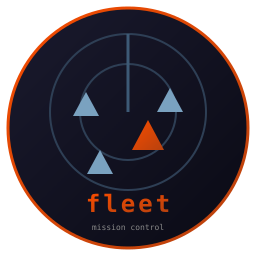

# fleet

   [](https://github.com/isene/fe2o3)



Claude Code mission control. One screen for every session on the
machine: who is working, who waits for you, on which workspace, with
what context size. Plus an inbox pane for the folders where handoffs
land (screenshots, phone transfers). Part of the
[Fe2O3](https://github.com/isene/fe2o3) Rust terminal suite.

<br clear="left"/>

## Sessions that work together

Sessions send each other messages, and act on them, with no relay from
you. One session finds a fault in another project and writes to the
session that owns it. That session gets the message when its turn ends,
or when fleet wakes it at its prompt. Then it starts on the job.

You stop carrying messages between your own sessions. More gets done at
once, and you steer less of it by hand.

What keeps you in charge:

- every message shows in the INBOX pane, and `M` lists them all
- auto-wake is set per session with `a`, at most 4 times in 30 minutes;
  a message from your phone wakes its session without it
- a session gets its messages once per turn, so two sessions cannot keep
  answering each other
- fleet never types into the window you are working in, unless the
  message came from your phone, since then you are away from it

Set it up under [Message bus](#message-bus).

## Why

Running several Claude Code sessions in parallel means losing track of
them. Which one finished and waits for an answer? Which workspace is it
on? Did that screenshot from the phone arrive? fleet answers all of
that at a glance, in one TUI.

## What it shows

**Sessions** (from `~/.claude/projects` transcripts):

- Tag (from [CC-sessions](https://github.com/isene/CC-sessions)
  bookmarks when present, else the project directory name)
- State: `working` (Claude has the turn), `YOURS` (waiting for you),
  `CAPPED` (a usage limit refused the model; needs `/model` or credits),
  `idle`, `off` (no process)
- ETA: the clock time the session gave for work still running, `?` for
  "ETA unknown". While a turn runs it is the latest one said in that
  turn, or else the one the turn before gave until that time passes;
  after it, the latest one its last answer gave. It turns red once that
  time has passed
- Age of last activity, workspace of its terminal window, context size,
  model, and the last prompt
- Sorted so CAPPED and YOURS float to the top
- Bookmarked sessions older than the recent window stay listed at the
  bottom as `older` (dim); unbookmarked old ones are dropped

**Inbox** (configurable watch folders):

- Files that recently arrived, newest first
- `o` opens the selected item, `D` deletes it (with confirm)

## Install

```sh
git clone https://github.com/isene/fleet
cd fleet
cargo build --release
ln -s "$PWD/target/release/fleet" ~/bin/fleet
```

Or take a build for Linux or macOS from the
[releases page](https://github.com/isene/fleet/releases). On a Mac,
fleet lists the sessions, their states and open items, and passes
messages. Workspaces and raising a session's window need X11, so they
work on Linux only.

## Keys

- `TAB` switch between sessions and inbox
- `↑` / `↓` select (shown as a background bar, colors kept)
- `Enter` on a session: raise its own glass (one of several stacked on
  a workspace) and jump to that workspace (xdotool key injection),
  or, when it has no window, resume it in a new glass terminal (detached
  through `setsid`, so it outlives fleet). With deck installed, that
  glass runs deck, which paints the session's colour in its own pane. A session on a gateway model
  (`cck`: Kimi through OpenRouter) is resumed through `cck`, so it stays
  on that model
- `m` on a session: type a message, Enter drops it on the bus
- `y` on a session: copy its session id to the clipboard, to hand another
  Claude session so it can read what happened there
- `w` on a session: set the workspace its glass opens on (1-9, `0` for
  10, `-` clears). The prompt is prefilled with the current value.
  Saved to `~/.fleetrc`, applied next time you resume it
- `b` on a session: pick its colour with `prism`, preloaded with the
  current colour. Saved to `~/.fleetrc`. deck paints it in its answer
  pane; a session resumed without deck gets it as its glass background
  (the `GLASS_BG` env)
- `t` on a session: set its window title, `#tag` when left empty. An open
  window is renamed at once. A resumed one starts with the title, and
  Claude Code is told to keep it (`CLAUDE_CODE_DISABLE_TERMINAL_TITLE`)
- `k` stop the selected session (SIGTERM; `K` forces): it goes "off"
  and stays resumable with Enter. A parked session loses its parking
  here, since "off" is what the row should say
- `p` park the selected session, or bring it back. A parked session
  stays listed, drops out of the YOURS and working counts, and sorts to
  the top as a block that does not move. Work clears it: the moment that
  session is busy again it shows as working, and the parking is gone
- `a` auto-wake for the selected session, on or off (shown as `»`).
  When a bus message lands for it, fleet asks it to check its messages
  by itself. Only while Claude waits at its prompt, never in the window
  you are typing in, and at most 4 times in 30 minutes
- `c` today's token rollup per session (Esc back)
- `v` popup with your open items, from all sessions: what each one
  still waits for you to do or decide, with its age and its number.
  The header counts them. Up and Down move the bar, Enter jumps to
  that row's session, and `d` deletes the item under the bar. See
  [Open items](#open-items)
- `/` search what every session has said: your prompts and Claude's
  answers, old sessions too. Type one word or several; a message is
  listed when all of them are in it, in any case. Newest first, at most
  300. Up and Down move the bar, Space shows the whole message, and
  Enter goes to its session: it jumps to an open one and resumes a
  closed one. Tool output is left out
- `o` / `Enter` on an inbox item: open it. A program that runs in a
  terminal (an editor, a PDF reader) gets a glass of its own
- `o` / `Enter` on a `msg` row: hand the message to the session it is
  for. A live session is told to read its mail right away; one that is
  off or old is resumed in a fresh glass first, then told once it is up.
  A `#phone` row is for the phone, and waits until the phone asks for its
  messages
- `<` on a `msg` row: clear that message. Delivery clears the rest by
  itself, so this is for one nothing will collect: a wrong tag, a
  session that is gone, or something you handled another way
- `d` flag for deletion (dark-red row, advances): inbox items, and
  idle/off sessions (transcript plus its subagent sidecar)
- `<` delete everything flagged
- `M` popup with the full bus message log (pending messages show as
  dim rows in the INBOX pane)
- `?` popup help with all keys
- `q` quit

Colors follow the Claude Code statusline: bookmark tags magenta, model
bold blue, ages gray, and context size on the statusline's own scale:
green under 50 % of the window, yellow under 75 %, red above.

`fleet --list` prints sessions and inbox as plain text; `fleet --today`
prints the rollup; `fleet --moves` prints your open items. `fleet
--search <words>` prints the 100 newest messages with all the words in
them.

`fleet --wake <tag>` types the check-messages prompt into that open
session, the same as Enter on an inbox row. All five exit immediately.

## Message bus

A message to a session is a file. `~/.fleet/bus/<addr>/` is the
mailbox, where `<addr>` is the session's CC-sessions bookmark tag (or
its raw session id). fleet's `m` key writes there; so can any Claude
session, which makes the path convention the whole API.

Delivery: the `hooks/fleet-bus` UserPromptSubmit hook injects pending
messages as context on the receiving session's next user prompt, then
deletes them. Install:

```sh
ln -s "$PWD/hooks/fleet-bus" ~/.claude/hooks/fleet-bus
```

and add it to `~/.claude/settings.json` under `hooks.UserPromptSubmit`:

```json
{ "type": "command", "command": "~/.claude/hooks/fleet-bus" }
```

When idle the hook is one stat of a usually absent directory.

The same hook can also run under `hooks.Stop`. A session that is already
working then gets its messages when its turn ends, with no prompt from
you. It delivers once per turn, so two sessions cannot keep answering
each other. The shell test in front skips Python when every mailbox is
empty:

```json
{ "type": "command", "timeout": 10,
  "command": "sh -c 'for f in \"$HOME\"/.fleet/bus/*/* \"$HOME\"/.fleet/relay/*/*; do [ -f \"$f\" ] && exec \"$HOME\"/.claude/hooks/fleet-bus; done; exit 0'" }
```

## Open items

A session that works for an hour asks you three things on the way, and
the next answer pushes each one off the screen. fleet keeps them: every
question and every action a session leaves with you stays listed under
`v` until that session closes it, or you delete it with `d`.

The list is live while it is open: a new item shows up within 2
seconds, and fleet goes on waking sessions under it. The same is true
for the help and the message log.

A session opens an item in its answer, in one of two ways:

- a row in a table that has a `Question` column, with the item's number
  in the first column
- a line that reads `7. Your move: ...`, with the item's number in front
  (`Your move 7: ...` is read too)

It closes items with a line `Closed: 3, 5`. The number of a closed item
is free again from the next answer on, so the numbers stay small: a new
item takes the lowest one that is not open.

You answer an item by starting a line of your prompt with its number,
as in `3 y` or `3: the second one`. fleet hides that item at once, while
the session works. It shows again when the turn ends, unless the answer
closed it.

The phone app's Drop deletes an item too, through the fleet server: a
file in the relay's `.drop` folder, which fleet reads when it changes.
It deletes the item only while its number still names the item the
phone showed.

The `fleet --hook` hook does both. It reads each prompt and each
finished answer, and keeps one small file per session in
`~/.fleet/open/`. When a number is missing or taken, it sends the answer
back once and names the first free number. An item is never dropped for
a fault: it gets the lowest free number.

Add the hook to `~/.claude/settings.json` under `hooks.Stop` and under
`hooks.UserPromptSubmit`:

```json
{ "type": "command", "timeout": 5, "command": "fleet --hook" }
```

and tell your sessions the two forms above, in `CLAUDE.md` or an output
style. The hook runs once per prompt and once per answer, in about 2 ms
each. A prompt or an answer that changes nothing touches no file.

### Finished turns, on the phone

With a relay folder (`~/.fleet/relay`, a Syncthing folder shared with the
host that runs `server/fleet-mcp.py`), the same hook writes
`done-<tag>.json` there at the end of every answer: the session's tag,
the time, the answer's first line, and its kind. Beside it goes
`answer-<tag>.txt`, the whole answer: HyperList as your screen shows it,
colours included, when the
[hyperlist-display](https://github.com/isene/hyperlist-display) hook is
at `~/.claude/hooks/hyperlist-display-asm`, else the markdown as written.

- An answer that gives an ETA ("ETA about 14:20", "ETA unknown", or a
  clock time after "about", "by" or "until", as in "finish at about
  14:20") means work goes on after it. The first later answer with no
  ETA and no "still running" ends that work, and goes out as kind `eta`
  with the ETA it had.
- Every other answer goes out as kind `turn`.
- A permission dialog that stays up a few seconds goes out as kind `ask`,
  with the tool and what it wants to run ("Bash: git push"). This needs
  a Notification hook with the matcher `permission_prompt` that runs
  `fleet --hook`. The hook also marks the dialog in `~/.fleet/ask/`, and
  the session list carries it as `ask` while the session still stops at
  that call; the turn's end removes the mark.

`server/fleet-mcp.py` serves them: a GET with `?done=SINCE&wait=SECS`
answers with the turns finished after SINCE, waiting up to 80 seconds
for one. The phone's fleet app in [nomad](https://github.com/isene/nomad)
asks it and rings for every turn, or only for ended ETA work and
dialogs that wait. The hook
writes nothing without a relay folder.

fleet itself writes `sessions.json` to the relay folder: the session
list as its screen shows it, with each session's open items and » mark,
and `usage`: the weekly limit as the header shows it (percent used, the
Fable share, when it resets). It writes when a state, ETA, prompt,
workspace, model, open item, » mark or the weekly use changes; age
and context size alone write nothing. A GET with
`?sessions=STAMP&wait=SECS` answers with the list once the file's time
differs from STAMP, or a new answer came. Each session in it carries
`answer`, the start of its last answer without colours. A GET with
`?answer=TAG` answers with the whole answer. The phone app shows the
list while its screen is open; a tap on a session shows its answer,
with a Yes and a No for each open item, and a long press sends that
session a message.

The phone app's open `?done=` request can also carry `&phone=N`, the
number of messages for the phone it knows of. The server then answers
early when that number changes, with the number and the newest
message's first line, so a red notice on the phone comes and goes with
the messages at no extra request.

## Configuration

`~/.fleetrc`, plain text, `#` comments. Any `inbox` line replaces the
built-in watches, so the tool adapts to where YOUR items land:

```
# inbox <label> <dir> <glob>
inbox scrots ~           *_scrot.png
inbox phone  ~/.transfer *
recent_days 7      # sessions younger than this are listed
idle_mins 30       # older than this and a live session shows "idle"
inbox_days 3       # inbox items younger than this are shown
ctx_window_k 1000  # context window; CTX goes yellow at 50 %, red at 75 %

# session <tag> <ws> [bg]   where a resumed session's glass opens.
#   ws is 1-based (- for none); bg is BARE hex, no leading # (the file
#   reads # as a comment). Set both live from the TUI with w and b.
session system 1
session asm    2
session rust   3
session DI     6 1a1a2e
```

The defaults are the inbox/recent/idle/inbox_days block above: laptop
screenshots in the home directory, phone items in `~/.transfer`. The
`session` lines are per-machine and easiest to set with `w` / `b` in
the TUI.

## Battery posture

A 2 second tick while open, nothing after `q`. Each tick is one `stat`
per session file (transcript tails are re-read only when mtime
changed), one `readdir` per inbox folder, and one `stat` of the
open-items folder, whose files are read again only after it changed.

One `readlink` per tick tells fleet when a newer build has replaced
the file it runs from. The footer then reads "is old: restart".

The token rollup reads whole transcripts, so it runs only on demand
(`c` or `--today`), never on the tick.

Two costs were measured and cut, from 170 wakeups a second to 21:

- The workspace map asked X for two properties per window and waited for
  each answer, ~370 blocking round trips a tick on a busy desktop. The
  requests are queued now, and the replies read in one pass.
- The `/proc` sweep for claude pids reads one `comm` per process on the
  machine. It runs every 10 seconds now; in between, each known pid is
  checked with a single `stat`, so a session that ends still drops out
  at once and one that starts appears within ten seconds.

## License

Public domain (Unlicense). Do what you want with it.
